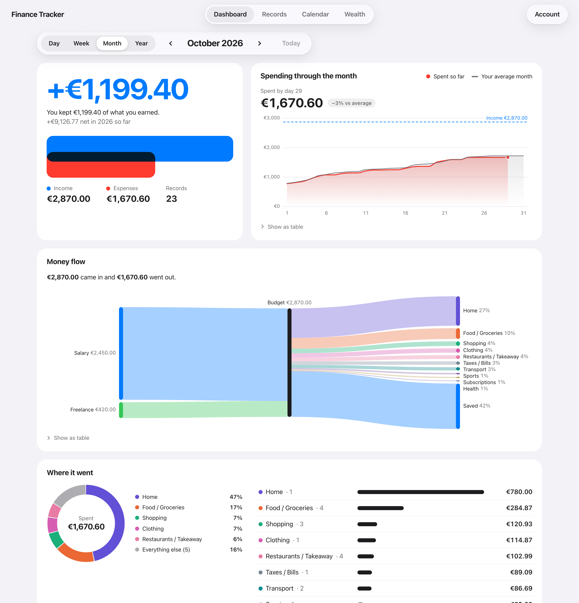
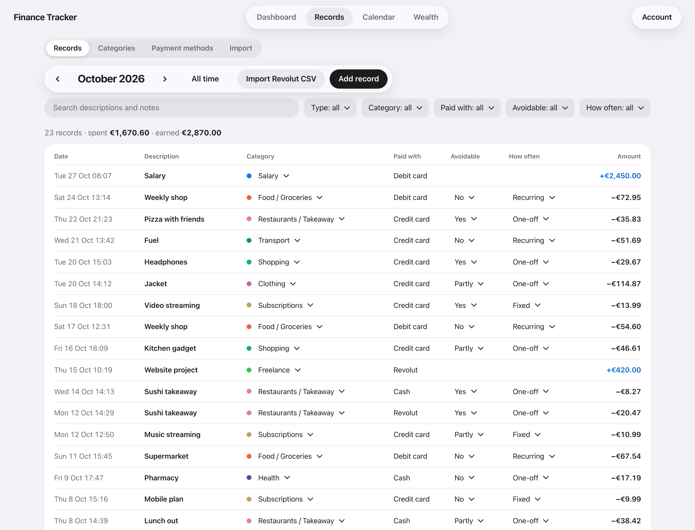
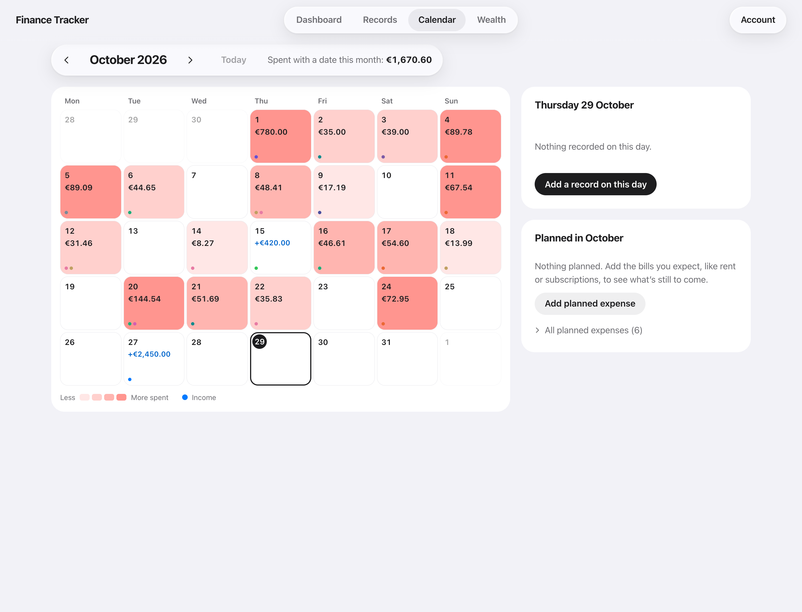
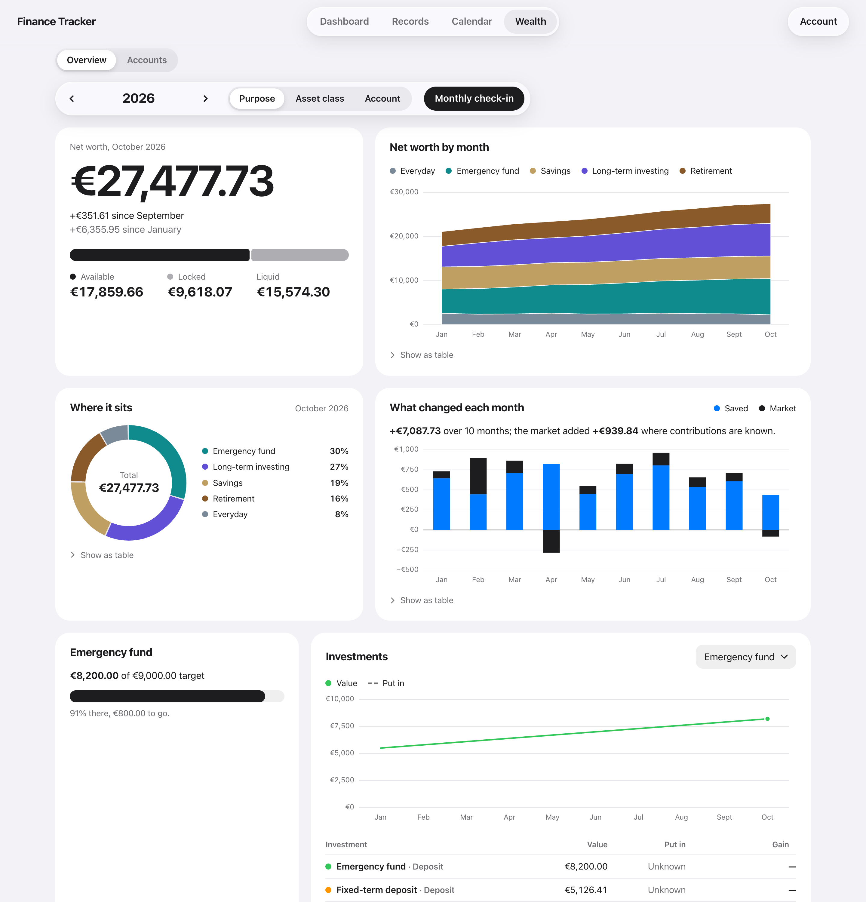
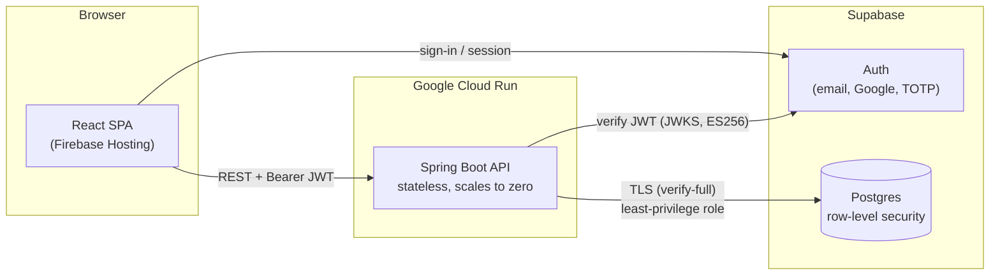

# Finance Tracker

A full-stack personal finance application for recording income and expenses, understanding spending behaviour, planning upcoming costs and tracking net worth over time.


> This repository is a portfolio piece. The application runs in production for private, invite-only use; the code is published to show its design and implementation, not as a project to self-host.

---

## Contents

- [Overview](#overview)
- [Features](#features)
- [Technical overview](#technical-overview)
  - [Architecture](#architecture)
  - [Tech stack](#tech-stack)
  - [Security model](#security-model)
  - [Engineering highlights](#engineering-highlights)
  - [Testing and delivery](#testing-and-delivery)
  - [Repository layout](#repository-layout)

---

## Overview

Finance Tracker replaces a Notion database and an Excel balance sheet with a single application built around two questions: *how am I doing?* and *why did I spend that?*

Besides recording **what** was spent, every record can capture **why**: whether the purchase was avoidable, how often it recurs, and the reason behind it (impulse, boredom, stress, …). The dashboard turns that into a clear picture of any day, week, month or year, while a separate wealth module follows net worth month by month across savings, investments and pension accounts.

The application is multi-tenant and invite-only. Every user sees only their own data, and that isolation is enforced by the database itself rather than by application code alone.

## Screenshots

*All figures shown are fictional demo data.*



| Records | Calendar | Wealth |
|---|---|---|
|  |  |  |

---

## Features

| Area | What it does |
|---|---|
| **Dashboard** | Balance, trend, spending by category, a Sankey money-flow diagram, payment-method split, avoidable spending and its reasons, and upcoming planned expenses, for any day, week, month or year. |
| **Records** | List and table views with rich filtering (date or month range, category, payment method, type, behavioural tags, free-text search). Records without an exact date still belong to their month and are never dropped. |
| **Custom lists** | Each user manages their own categories and payment methods, with colours. Deleting one that is still in use asks where to move its records first. |
| **Bank import** | Revolut CSV import (Italian and English exports) with a preview step: transfers, cancelled and pending rows are skipped, foreign-currency rows are flagged instead of silently converted, fees are added, categories are suggested from history, and re-importing the same file never creates duplicates. |
| **Calendar** | Records laid out by month, showing when money moves. |
| **Planned expenses** | One-off, monthly, quarterly or annual rules. Each occurrence is tracked as paid, skipped, overdue or upcoming, with a suggested matching record that can be linked, or paid in one step. |
| **Wealth** | Accounts tagged by purpose and asset class, a guided monthly check-in, net worth split into available and locked funds, each month's change separated into money saved versus market movement, emergency-fund progress, and investment gain or loss against capital contributed. |
| **Account** | Email and password or Google sign-in, password reset, TOTP two-factor authentication, and automatic sign-out after inactivity. |

The interface follows Apple's Liquid Glass design language, adapts to light and dark mode, and works on desktop and phone. All charts are hand-drawn SVG and each one has an accessible table alternative.

---

## Technical overview

### Architecture



1. The **single-page app** authenticates with Supabase Auth using only public credentials, then calls the API with the user's access token.
2. The **API** verifies each token's signature, issuer, audience and expiry against Supabase's published keys. The caller's identity is taken from the token and nowhere else.
3. Every query runs in a transaction as Postgres's `authenticated` role with the caller's claims attached, so **row-level security decides what each user can read and write**.

### Tech stack

| Layer | Technology |
|---|---|
| **Frontend** | React 19, TypeScript, Vite, `supabase-js`; hash routing for static hosting; oxlint |
| **Visualisation** | Custom SVG components (stacked areas, lines, diverging bars, donut, Sankey), with no chart library |
| **Backend** | Spring Boot 4.1, Java 17, Spring Security OAuth2 Resource Server, `JdbcClient` (no ORM) |
| **Database** | PostgreSQL on Supabase, versioned SQL migrations, row-level security policies |
| **Authentication** | Supabase Auth: email and password, Google OAuth, TOTP multi-factor |
| **Infrastructure** | Docker (multi-stage, non-root), Google Cloud Run, Firebase Hosting, Secret Manager |
| **CI/CD** | GitHub Actions with keyless Workload Identity Federation, Dependabot |

### Security model

Security is layered so that a mistake in one layer does not expose data on its own.

| Concern | Approach |
|---|---|
| **Tenant isolation** | Every table carries a `user_id` and RLS policies restrict rows to `auth.uid()`. The API also scopes each query by user. |
| **Least privilege** | The API connects as a role with **no table privileges of its own** (`NOINHERIT`). Any query that skips the per-request role switch fails closed. |
| **Two-factor enforcement** | A *restrictive* RLS policy requires an `aal2` token for users who have enrolled an authenticator, so 2FA is enforced by the database, not just the UI. |
| **Idle sessions** | The database keeps an inactivity deadline per session, extended by each API request. Once it passes, a restrictive policy refuses the session on every table, even with a freshly refreshed token. |
| **Token validation** | ES256 signatures against the JWKS, plus issuer, audience and expiry checks. |
| **Transport** | The database connection uses `verify-full` TLS against the provider's root CA. |
| **Input and resource limits** | Parameterised SQL throughout, request-body size caps, text-length limits, amount range validation, and a bounded transaction time per request. |
| **Browser hardening** | Strict Content-Security-Policy, `no-referrer`, `frame-ancestors 'none'`, `nosniff`, and an explicit CORS allowlist. |
| **Errors** | RFC 9457 problem details that expose only the application's own messages. |
| **Secrets and deployment** | No secrets in the repository or the browser bundle. Production credentials live in Secret Manager, and CI deploys with short-lived, keyless credentials scoped to the main branch of this repository. |
| **Access** | Invite-only: public sign-up is disabled and Google sign-in cannot create accounts. |

### Engineering highlights

- **The database as the security boundary.** Rather than relying on every controller to filter correctly, a single data-access path (`UserDb`) switches into the caller's identity for each transaction, and Postgres enforces ownership, MFA and session expiry.
- **Bank-statement import that is safe to repeat.** The Revolut parser handles two localised export formats, normalises fees and statuses, and relies on a database uniqueness constraint so that importing the same file twice is harmless.
- **Recurring plans without stored occurrences.** Planned expenses are stored as rules and expanded on demand into dated occurrences, with only exceptions (paid or skipped) persisted. Matching suggests an existing record for each occurrence.
- **Wealth analytics.** Monthly balances combined with contributions separate *saved* money from *market* movement, giving an honest view of investment performance.
- **No chart library.** Every visualisation, including the Sankey diagram, is a small hand-written SVG component that reads its colours from CSS design tokens and works in light and dark mode.
- **Cost-aware hosting.** The API is stateless and scales to zero; maximum instances are capped to bound database connections and spend.

### Testing and delivery

- **API:** JUnit tests for dashboard aggregation, plan expansion, CSV parsing, wealth validation and request limits.
- **Database:** a SQL test suite for the session idle-timeout policies, run against a migrated database.
- **Web:** strict TypeScript build, linting, and a self-check for the wealth calculations.
- **CI/CD:** pushes to `main` run the relevant tests and deploy only what changed: the API as a container image to Cloud Run, the web app to Firebase Hosting. A failing test blocks deployment. The API image is also rebuilt monthly so base-image security patches ship without code changes.

### Repository layout

```
├── api/                    Spring Boot REST API
│   ├── src/main/java/…     controllers, domain logic, security config, UserDb
│   ├── src/test/java/…     unit tests
│   └── Dockerfile
├── web/                    React single-page app
│   └── src/                pages, SVG charts, design tokens
├── supabase/
│   ├── migrations/         schema, RLS policies, MFA and session enforcement
│   └── tests/              SQL policy tests
├── .github/                deployment workflows, Dependabot
├── PRODUCT.md              product decisions and data model
└── DESIGN.md               design system
```
