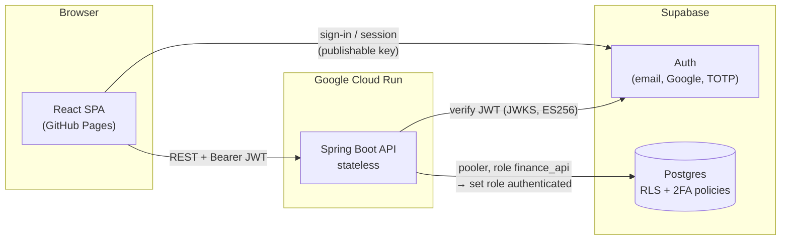

# Finance Tracker

A personal finance app for recording every expense and income, understanding where the money goes, planning what's coming, and watching net worth grow month by month.

It started as a replacement for a Notion finance tracker and an Excel balance sheet. Besides *what* was spent, it records *why*: whether a purchase was avoidable, and the reason behind it (impulse, boredom, stress…).


---

## Contents

- [Features](#features)
- [Architecture](#architecture)
- [Tech stack](#tech-stack)
- [Security](#security)
- [Project structure](#project-structure)
- [Getting started](#getting-started)
- [API reference](#api-reference)
- [Testing](#testing)
- [Deployment](#deployment)

---

## Features

### 📊 Dashboard
One page that answers *"how am I doing?"* for a **day, week, month or year**, with previous and next stepping.

- **Balance**: income, expenses and what's left for the period.
- **Trend**: day by day, spending through the month, or income and expenses by month, depending on the period.
- **Where it went**: spending by category.
- **Money flow**: a Sankey diagram from income sources, through the budget, into spending categories and savings.
- **Paid with**: the split by payment method.
- **Avoidable spending**: how much could have been avoided, and why it happened.
- **How often you spend**: fixed, recurring and one-off costs.
- **Planned and coming up**: planned expenses due in the period and the next ones ahead.

All charts are hand-drawn SVG, with no chart library. Each one has an accessible table alternative.

### 🧾 Records
- **Browse records** in a list or a table, with filters:
  - month range, or an exact date range
  - category and payment method
  - type
  - avoidable and recurrence (including "untagged")
  - free-text search
- **Add, edit and delete** records. Each record has these fields:
  - **Basics:** description, amount, type, date
  - **Lists:** category, payment method
  - **Behaviour:** avoidable (*Yes / Partly / No*), recurrence (*Fixed / Recurring / One-off*), reason
  - **Free text:** notes
- **Records without an exact date** still belong to a month. They appear in a dedicated "no exact date" group and are never dropped.
- **Per-user lists**: you can add, rename, recolour and delete your own categories and payment methods. If records still use one, you're asked where to move them before it is deleted.

### 📥 Revolut CSV import
- Accepts both the **Italian and the English** Revolut export.
- **Preview first:** see what will be added, skipped or flagged before anything is saved.
- **Skipped:** top-ups (transfers between your own accounts), cancelled payments and pending ones.
- **Flagged:** rows in a currency other than EUR. They are never converted silently.
- **Fees** are added to the expense.
- **Categories:** suggested from the last category you picked for the same description.
- **No duplicates:** re-importing the same file is safe, because the database rejects duplicate rows.

### 🗓️ Calendar
The same records laid out by month, so you can see when money moves.

### 📌 Planned expenses
- **Rules:** *Once, Monthly, Quarterly* or *Annual*, with a start and an optional end.
- **Status of each occurrence:** **paid**, **skipped**, **overdue** or **upcoming**.
- **Matching:** the app suggests an existing record that matches an occurrence. You can link it, skip the occurrence, or **pay** it, which creates and links the record in one step.

### 💰 Wealth
A monthly picture of where the money sits, separate from the records.

- **Accounts:**
  - Each one is tagged with a **purpose** (*Everyday, Emergency fund, Savings, Long-term investing, Retirement*) and an **asset class** (*Cash, Deposit, Bonds, Equities, Mixed, Insurance policy, Pension fund*).
  - Optional fields: lock-up date, target, notes, and opening and closing months.
- **Monthly check-in:**
  - A side sheet pre-filled with last month's values. You update each balance and, for investments, how much you put in or took out.
  - It shows the running total as you type.
- **Net worth:**
  - Shows the change since last month and since January.
  - Splits the total into **available vs locked**, and shows the liquid amount.
- **Charts:**
  - **Net worth by month:** stacked by purpose, asset class or account.
  - **Where it sits:** an allocation donut.
  - **What changed each month:** each month's change split into **saved** money and **market** movement.
  - **Emergency fund:** progress towards a target.
  - **Investments:** value vs money put in, with the gain or loss per account.
- **Balances grid:** a spreadsheet-like view of every account by month. Missing balances are marked.

### 🔐 Account
- **Invite-only access.** There is no public sign-up.
- **Sign-in:** email and password, or Google.
- **Passwords:** you can change yours or reset it by email.
- **Two-factor authentication** with an authenticator app (TOTP). Once it is on, the database enforces it on every request.

---

## Architecture



1. The **SPA** signs the user in with Supabase Auth, using only the public key, and sends the access token with every API call.
2. The **API** verifies the token's signature, issuer, audience and expiry against Supabase's published keys. The user's identity comes only from the token.
3. Every query runs inside a transaction as Postgres's `authenticated` role, with the caller's claims attached. **Row-level security** therefore decides what each user can see, in the database itself.

---

## Tech stack

| Layer | Choice |
|---|---|
| **Frontend** | React 19, TypeScript 7, Vite 8, `@supabase/supabase-js` |
| **Charts** | Hand-written SVG components (stacked areas, lines, diverging bars, donut, Sankey), with no chart library |
| **Typography** | System font (SF Pro on Apple devices), no web font |
| **Routing** | Hash routing (`#/dashboard`, `#/records`, …), so it works on static hosting |
| **Linting** | oxlint |
| **Backend** | Spring Boot 4.1, Java 17, Maven; Spring Security OAuth2 Resource Server; `JdbcClient` (no ORM) |
| **Database** | Supabase Postgres, with SQL migrations in `supabase/migrations` |
| **Auth** | Supabase Auth: email and password, Google OAuth, TOTP 2FA |
| **Container** | Multi-stage Dockerfile running as a non-root user |

---

## Security

| Concern | How it's handled |
|---|---|
| **Tenant isolation** | Every table has `user_id` and RLS policies `user_id = auth.uid()`. The API also scopes each query by user. |
| **Least privilege** | The API logs in as `finance_api`, which has **no table rights of its own** (`NOINHERIT`). A query that skips the per-request role switch fails closed. |
| **2FA** | A *restrictive* RLS policy requires an `aal2` token once a user has a verified authenticator. |
| **Token checks** | ES256 signature against the JWKS, plus issuer, `aud = authenticated` and expiry. |
| **Invite-only** | Public sign-up is disabled, and Google sign-in can't create accounts. |
| **CORS** | Only an explicit allowlist of origins. |
| **CSRF** | Not applicable: there are bearer tokens only, no cookies, and the API is stateless. |
| **SQL injection** | Every query uses parameters. |
| **Browser** | Production builds ship a strict Content-Security-Policy `<meta>` and `no-referrer`. |
| **Errors** | RFC 9457 problem details that expose only the app's own messages. The health endpoint shows no details. |
| **Secrets** | Kept only in gitignored `.env` files or server environment variables. The browser gets only public values. |

---

## Project structure

```
Finance-Tracker/
├── api/                          Spring Boot REST API
│   ├── src/main/java/app/financetracker/api/
│   │   ├── SecurityConfig.java   JWT resource server + CORS
│   │   ├── UserDb.java           the only path to the DB (RLS as the caller)
│   │   ├── DashboardController.java · Dashboard.java
│   │   ├── RecordsController.java · RevolutCsv.java
│   │   ├── ListsController.java  categories & payment methods
│   │   ├── PlansController.java · Plans.java
│   │   └── WealthController.java
│   ├── src/test/java/…           unit tests
│   ├── Dockerfile
│   └── .env.example
├── web/                          React SPA
│   ├── src/
│   │   ├── App.tsx               tabs, routing, auth gate
│   │   ├── Auth.tsx · Account.tsx
│   │   ├── Dashboard.tsx · Charts.tsx
│   │   ├── RecordsPage.tsx · Records.tsx · Import.tsx · Lists.tsx
│   │   ├── Calendar.tsx · PlanPanel.tsx
│   │   ├── Wealth.tsx · wealthMath.ts (+ .check.ts)
│   │   └── index.css             design tokens & styles
│   ├── vite.config.ts            CSP injection, base path
│   └── .env.example
├── supabase/migrations/          schema, RLS, 2FA, plans, wealth
└── PRODUCT.md                    product decisions and data model
```

---

## Getting started

### Prerequisites
- **Java 17+**, used by the bundled Maven wrapper.
- **Node.js 24+**.
- **A Supabase project** with:
  - public sign-up disabled
  - optionally, Google OAuth and TOTP MFA enabled

### 1. Database
- Apply the SQL files in `supabase/migrations/` in order, with the Supabase CLI or the SQL editor.
- The first migration assigns legacy rows to an owner account. Replace `owner@example.com` in it with your user's email, or drop that section on a fresh project.
- Create the API's login role password out of band (it is never committed), for example:
  ```sql
  alter role finance_api with password '…';
  ```

### 2. API
```bash
cd api
cp .env.example .env      # fill in SUPABASE_URL, DB_URL, DB_USER, DB_PASSWORD, CORS_ORIGINS
./mvnw spring-boot:run    # http://localhost:8080
```

| Variable | Purpose |
|---|---|
| `SUPABASE_URL` | Project URL, used to verify tokens (`/auth/v1/.well-known/jwks.json`) |
| `DB_URL` | JDBC URL of the Supabase **session pooler** (works over IPv4) |
| `DB_USER` / `DB_PASSWORD` | The `finance_api` role (`finance_api.<project-ref>` on the pooler) |
| `CORS_ORIGINS` | Comma-separated allowed origins |
| `PORT` | Optional; defaults to `8080` |

### 3. Web
```bash
cd web
cp .env.example .env.local   # VITE_SUPABASE_URL, VITE_SUPABASE_PUBLISHABLE_KEY, VITE_API_URL
npm install
npm run dev                  # http://localhost:5173
```

> **Using it from your phone:** the dev server listens on your local network. Set `VITE_API_URL` to your machine's LAN IP, and add `http://<lan-ip>:5173` to `CORS_ORIGINS` and to the Supabase Auth redirect URLs.

---

## API reference

All endpoints are under `/api` and need `Authorization: Bearer <supabase access token>`.

| Method | Path | Description |
|---|---|---|
| `GET` | `/dashboard?period=DAY\|WEEK\|MONTH\|YEAR&date=` | All dashboard figures for a period |
| `GET` `POST` | `/records` | List (filterable) or create records |
| `PUT` `DELETE` | `/records/{id}` | Update or delete a record |
| `POST` | `/records/import/revolut/preview` | Parse a CSV and show what would happen (writes nothing) |
| `POST` | `/records/import/revolut` | Insert the confirmed rows |
| `GET` | `/lists` | Categories and payment methods |
| `POST` `PUT` `DELETE` | `/categories/{id}`, `/payment-methods/{id}` | Manage lists (`DELETE ?reassignTo=` moves records first) |
| `GET` `POST` | `/plans` | Planned-expense rules |
| `PUT` `DELETE` | `/plans/{id}` | Edit or remove a rule |
| `GET` | `/plans/occurrences?from=&to=` | Occurrences with status and a suggested matching record |
| `PUT` `DELETE` | `/plans/{id}/occurrences/{due}` | Link a record, skip, or reset an occurrence |
| `POST` | `/plans/{id}/occurrences/{due}/pay` | Create the record and link it |
| `GET` | `/wealth` | Accounts and all monthly balances |
| `POST` | `/wealth/accounts` | Create an account |
| `PUT` `DELETE` | `/wealth/accounts/{id}` | Edit or delete an account (and its balances) |
| `PUT` | `/wealth/balances/{month}` | Save a whole monthly check-in in one transaction |
| `GET` | `/actuator/health` | Health check (public) |

Errors are returned as [RFC 9457](https://www.rfc-editor.org/rfc/rfc9457) problem details.

---

## Testing

```bash
cd api && ./mvnw test                      # dashboard, plans, Revolut CSV, wealth validation
cd web && npm run build                    # type-check + production build
cd web && node src/wealthMath.check.ts     # wealth maths self-check
cd web && npm run lint                     # oxlint
```

---

## Deployment

The project is built to deploy without code changes:

- **Web → GitHub Pages:**
  - Build with `VITE_BASE=/<repo>/` and the production `VITE_API_URL`.
  - The build injects the Content-Security-Policy as a `<meta>` tag, because Pages can't send headers.
- **API → Google Cloud Run:**
  - Build the container from `api/Dockerfile`.
  - Set the variables above as environment variables or in Secret Manager. Cloud Run provides `PORT`.
- **Supabase:**
  - Add the Pages origin to the Auth redirect URLs.
  - Add the same origin to the API's `CORS_ORIGINS`.

---

<sub>A personal project. Amounts are in EUR; dates are shown in Europe/Rome time.</sub>
