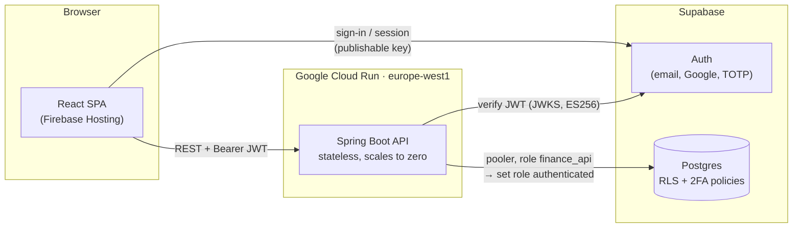

# Finance Tracker

A personal finance app for recording every expense and income, understanding where the money goes, planning what's coming, and watching net worth grow month by month.

It started as a replacement for a Notion finance tracker and an Excel balance sheet. Besides *what* was spent, it records *why*: whether a purchase was avoidable, and the reason behind it (impulse, boredom, stress…).


**Live:** <https://finance-tracker-dooney.web.app> (invite-only)

---

## Contents

- [Features](#features)
- [Architecture](#architecture)
- [Tech stack](#tech-stack)
- [Security](#security)
- [Project structure](#project-structure)
- [Getting started](#getting-started)
- [API reference](#api-reference)
- [Testing](#testing)
- [Deployment](#deployment)

---

## Features

### 📊 Dashboard
One page that answers *"how am I doing?"* for a **day, week, month or year**, with previous and next stepping.

- **Balance**: income, expenses and what's left for the period.
- **Trend**: day by day, spending through the month, or income and expenses by month, depending on the period.
- **Where it went**: spending by category.
- **Money flow**: a Sankey diagram from income sources, through the budget, into spending categories and savings.
- **Paid with**: the split by payment method.
- **Avoidable spending**: how much could have been avoided, and why it happened.
- **How often you spend**: fixed, recurring and one-off costs.
- **Planned and coming up**: planned expenses due in the period and the next ones ahead.

All charts are hand-drawn SVG, with no chart library. Each one has an accessible table alternative.

### 🧾 Records
- **Browse records** in a list or a table, with filters:
  - month range, or an exact date range
  - category and payment method
  - type
  - avoidable and recurrence (including "untagged")
  - free-text search
- **Add, edit and delete** records. Each record has these fields:
  - **Basics:** description, amount, type, date
  - **Lists:** category, payment method
  - **Behaviour:** avoidable (*Yes / Partly / No*), recurrence (*Fixed / Recurring / One-off*), reason
  - **Free text:** notes
- **Records without an exact date** still belong to a month. They appear in a dedicated "no exact date" group and are never dropped.
- **Per-user lists**: you can add, rename, recolour and delete your own categories and payment methods. If records still use one, you're asked where to move them before it is deleted.

### 📥 Revolut CSV import
- Accepts both the **Italian and the English** Revolut export.
- **Preview first:** see what will be added, skipped or flagged before anything is saved.
- **Skipped:** top-ups (transfers between your own accounts), cancelled payments and pending ones.
- **Flagged:** rows in a currency other than EUR. They are never converted silently.
- **Fees** are added to the expense.
- **Categories:** suggested from the last category you picked for the same description.
- **No duplicates:** re-importing the same file is safe, because the database rejects duplicate rows.

### 🗓️ Calendar
The same records laid out by month, so you can see when money moves.

### 📌 Planned expenses
- **Rules:** *Once, Monthly, Quarterly* or *Annual*, with a start and an optional end.
- **Status of each occurrence:** **paid**, **skipped**, **overdue** or **upcoming**.
- **Matching:** the app suggests an existing record that matches an occurrence. You can link it, skip the occurrence, or **pay** it, which creates and links the record in one step.

### 💰 Wealth
A monthly picture of where the money sits, separate from the records.

- **Accounts:**
  - Each one is tagged with a **purpose** (*Everyday, Emergency fund, Savings, Long-term investing, Retirement*) and an **asset class** (*Cash, Deposit, Bonds, Equities, Mixed, Insurance policy, Pension fund*).
  - Optional fields: lock-up date, target, notes, and opening and closing months.
- **Monthly check-in:**
  - A side sheet pre-filled with last month's values. You update each balance and, for investments, how much you put in or took out.
  - It shows the running total as you type.
- **Net worth:**
  - Shows the change since last month and since January.
  - Splits the total into **available vs locked**, and shows the liquid amount.
- **Charts:**
  - **Net worth by month:** stacked by purpose, asset class or account.
  - **Where it sits:** an allocation donut.
  - **What changed each month:** each month's change split into **saved** money and **market** movement.
  - **Emergency fund:** progress towards a target.
  - **Investments:** value vs money put in, with the gain or loss per account.
- **Balances grid:** a spreadsheet-like view of every account by month. Missing balances are marked.

### 🔐 Account
- **Invite-only access.** There is no public sign-up.
- **Sign-in:** email and password, or Google.
- **Passwords:** you can change yours or reset it by email.
- **Two-factor authentication** with an authenticator app (TOTP). Once it is on, the database enforces it on every request.

---

## Architecture



1. The **SPA** signs the user in with Supabase Auth, using only the public key, and sends the access token with every API call.
2. The **API** verifies the token's signature, issuer, audience and expiry against Supabase's published keys. The user's identity comes only from the token.
3. Every query runs inside a transaction as Postgres's `authenticated` role, with the caller's claims attached. **Row-level security** therefore decides what each user can see, in the database itself.

---

## Tech stack

| Layer | Choice |
|---|---|
| **Frontend** | React 19, TypeScript 7, Vite 8, `@supabase/supabase-js` |
| **Charts** | Hand-written SVG components (stacked areas, lines, diverging bars, donut, Sankey), with no chart library |
| **Typography** | System font (SF Pro on Apple devices), no web font |
| **Routing** | Hash routing (`#/dashboard`, `#/records`, …), so it works on static hosting |
| **Linting** | oxlint |
| **Backend** | Spring Boot 4.1, Java 17, Maven; Spring Security OAuth2 Resource Server; `JdbcClient` (no ORM) |
| **Database** | Supabase Postgres, with SQL migrations in `supabase/migrations` |
| **Auth** | Supabase Auth: email and password, Google OAuth, TOTP 2FA |
| **Container** | Multi-stage Dockerfile running as a non-root user |
| **Hosting** | Firebase Hosting (SPA), Google Cloud Run (API), both in Google Cloud project `finance-tracker-dooney` |
| **CI/CD** | GitHub Actions on push to `main`, signed in to Google Cloud with Workload Identity Federation |

---

## Security

| Concern | How it's handled |
|---|---|
| **Tenant isolation** | Every table has `user_id` and RLS policies `user_id = auth.uid()`. The API also scopes each query by user. |
| **Least privilege** | The API logs in as `finance_api`, which has **no table rights of its own** (`NOINHERIT`). A query that skips the per-request role switch fails closed. |
| **2FA** | A *restrictive* RLS policy requires an `aal2` token once a user has a verified authenticator. |
| **Idle timeout** | A session unused for `SESSION_IDLE_TIMEOUT` (default 30 min) is refused. The database keeps a deadline for each session, and every API request extends it. Once the deadline passes, the session can't be revived, not even with a refreshed token, and a restrictive RLS policy blocks it on every table. The web app pings the API while you're active, signs you out when you go idle, and tells you why. |
| **Token checks** | ES256 signature against the JWKS, plus issuer, `aud = authenticated` and expiry. |
| **Invite-only** | Public sign-up is disabled, and Google sign-in can't create accounts. |
| **CORS** | Only an explicit allowlist of origins. |
| **CSRF** | Not applicable: there are bearer tokens only, no cookies, and the API is stateless. |
| **SQL injection** | Every query uses parameters. |
| **Browser** | Production builds ship a strict Content-Security-Policy `<meta>` and `no-referrer`; Firebase Hosting adds `frame-ancestors 'none'` as a header. |
| **Errors** | RFC 9457 problem details that expose only the app's own messages. The health endpoint shows no details. |
| **Secrets** | Locally in gitignored `.env` files; in production the DB password lives in Secret Manager, readable only by the API's own service account. The browser gets only public values. |
| **Deploy access** | No service-account keys exist. GitHub Actions gets short-lived credentials through Workload Identity Federation, and only from `main` of this repo (matched by its numeric ID, so a re-created repo with the same name gets nothing). The deployer can push images, deploy the service, publish Hosting and check which APIs are enabled, nothing else. |
| **Dependencies** | Dependabot alerts and security fixes are on, with grouped monthly update PRs for npm, Maven and Actions. The API image is rebuilt monthly so base-image patches ship even without code changes. |

---

## Project structure

```
Finance-Tracker/
├── .github/                      workflows/deploy-api.yml · workflows/deploy-web.yml · dependabot.yml
├── api/                          Spring Boot REST API
│   ├── src/main/java/app/financetracker/api/
│   │   ├── SecurityConfig.java   JWT resource server + CORS
│   │   ├── UserDb.java           the only path to the DB (RLS as the caller)
│   │   ├── DashboardController.java · Dashboard.java
│   │   ├── RecordsController.java · RevolutCsv.java
│   │   ├── ListsController.java  categories & payment methods
│   │   ├── PlansController.java · Plans.java
│   │   └── WealthController.java
│   ├── src/test/java/…           unit tests
│   ├── Dockerfile
│   └── .env.example
├── web/                          React SPA
│   ├── src/
│   │   ├── App.tsx               tabs, routing, auth gate
│   │   ├── Auth.tsx · Account.tsx
│   │   ├── Dashboard.tsx · Charts.tsx
│   │   ├── RecordsPage.tsx · Records.tsx · Import.tsx · Lists.tsx
│   │   ├── Calendar.tsx · PlanPanel.tsx
│   │   ├── Wealth.tsx · wealthMath.ts (+ .check.ts)
│   │   └── index.css             design tokens & styles
│   ├── vite.config.ts            CSP injection
│   └── .env.example
├── supabase/migrations/          schema, RLS, 2FA, plans, wealth
├── firebase.json                 Firebase Hosting: serves web/dist, security headers
└── PRODUCT.md                    product decisions and data model
```

---

## Getting started

### Prerequisites
- **Java 17+**, used by the bundled Maven wrapper.
- **Node.js 24+**.
- **A Supabase project** with:
  - public sign-up disabled
  - optionally, Google OAuth and TOTP MFA enabled

### 1. Database
- Apply the SQL files in `supabase/migrations/` in order, with the Supabase CLI or the SQL editor.
- The first migration assigns legacy rows to an owner account. Replace `owner@example.com` in it with your user's email, or drop that section on a fresh project.
- Create the API's login role password out of band (it is never committed), for example:
  ```sql
  alter role finance_api with password '…';
  ```

### 2. API
```bash
cd api
cp .env.example .env      # fill in SUPABASE_URL, DB_URL, DB_USER, DB_PASSWORD, CORS_ORIGINS
./mvnw spring-boot:run    # http://localhost:8080
```

| Variable | Purpose |
|---|---|
| `SUPABASE_URL` | Project URL, used to verify tokens (`/auth/v1/.well-known/jwks.json`) |
| `DB_URL` | JDBC URL of the Supabase **session pooler** (works over IPv4) |
| `DB_USER` / `DB_PASSWORD` | The `finance_api` role (`finance_api.<project-ref>` on the pooler) |
| `CORS_ORIGINS` | Comma-separated allowed origins |
| `SESSION_IDLE_TIMEOUT` | Optional; idle time before a session is refused, e.g. `30m` (default). Keep `VITE_SESSION_IDLE_MINUTES` in the web app equal |
| `PORT` | Optional; defaults to `8080` |

### 3. Web
```bash
cd web
cp .env.example .env.local   # VITE_SUPABASE_URL, VITE_SUPABASE_PUBLISHABLE_KEY, VITE_API_URL
npm install
npm run dev                  # http://localhost:5173
```

> **Using it from your phone:** the dev server listens on your local network. Set `VITE_API_URL` to your machine's LAN IP and add `http://<lan-ip>:5173` to `CORS_ORIGINS` in `api/.env`. Signing in with a password works as is. **Don't add LAN or other `http://` origins to the Supabase redirect URLs**: development shares the production project, so every entry there is a trusted redirect for real users' sign-in and reset links. To test Google sign-in or email links on a phone, use a separate Supabase project for development, or an HTTPS tunnel to a hostname you own.

---

## API reference

All endpoints are under `/api` and need `Authorization: Bearer <supabase access token>`.

| Method | Path | Description |
|---|---|---|
| `GET` | `/dashboard?period=DAY\|WEEK\|MONTH\|YEAR&date=` | All dashboard figures for a period |
| `GET` `POST` | `/records` | List (filterable) or create records |
| `PUT` `DELETE` | `/records/{id}` | Update or delete a record |
| `POST` | `/records/import/revolut/preview` | Parse a CSV and show what would happen (writes nothing) |
| `POST` | `/records/import/revolut` | Insert the confirmed rows |
| `POST` | `/session` | Keep-alive while you're active; `401` once the session has gone idle |
| `GET` | `/lists` | Categories and payment methods |
| `POST` `PUT` `DELETE` | `/categories/{id}`, `/payment-methods/{id}` | Manage lists (`DELETE ?reassignTo=` moves records first) |
| `GET` `POST` | `/plans` | Planned-expense rules |
| `PUT` `DELETE` | `/plans/{id}` | Edit or remove a rule |
| `GET` | `/plans/occurrences?from=&to=` | Occurrences with status and a suggested matching record |
| `PUT` `DELETE` | `/plans/{id}/occurrences/{due}` | Link a record, skip, or reset an occurrence |
| `POST` | `/plans/{id}/occurrences/{due}/pay` | Create the record and link it |
| `GET` | `/wealth` | Accounts and all monthly balances |
| `POST` | `/wealth/accounts` | Create an account |
| `PUT` `DELETE` | `/wealth/accounts/{id}` | Edit or delete an account (and its balances) |
| `PUT` | `/wealth/balances/{month}` | Save a whole monthly check-in in one transaction |
| `GET` | `/actuator/health` | Health check (public) |

Errors are returned as [RFC 9457](https://www.rfc-editor.org/rfc/rfc9457) problem details.

---

## Testing

```bash
cd api && ./mvnw test                      # dashboard, plans, Revolut CSV, wealth validation
cd web && npm run build                    # type-check + production build
cd web && node src/wealthMath.check.ts     # wealth maths self-check
cd web && npm run lint                     # oxlint
psql "$DB" -v ON_ERROR_STOP=1 -f supabase/tests/session_idle_timeout.sql   # idle timeout, against a DB with the migrations applied
```

CI runs `./mvnw test` before every API deploy and `npm run build` before every web deploy. If either one fails, nothing is deployed.

---

## Deployment

| | |
|---|---|
| **App** | <https://finance-tracker-dooney.web.app> (Firebase Hosting) |
| **API** | <https://finance-api-822617122001.europe-west1.run.app> (Cloud Run service `finance-api`) |
| **Google Cloud project** | `finance-tracker-dooney`, region `europe-west1` (closest to Supabase's `eu-west-1`) |

Pushing to `main` deploys whatever changed:

| Workflow | Runs when | Does |
|---|---|---|
| `.github/workflows/deploy-api.yml` | `api/**` changes, and on the 1st of each month | `mvnw test` → build `api/Dockerfile` → push to Artifact Registry `finance` → deploy to Cloud Run |
| `.github/workflows/deploy-web.yml` | `web/**` or `firebase.json` changes | `npm run build` → Firebase Hosting |

To redeploy without a code change: `gh workflow run deploy-api.yml` or `gh workflow run deploy-web.yml`.

### Where the config lives
- **API:** the env vars and the `db-password` secret are set **on the Cloud Run service**, not in the repo. CI only swaps the image, so they stay put. To change one:
  ```bash
  gcloud run services update finance-api --region europe-west1 --update-env-vars CORS_ORIGINS=https://…
  ```
- **Web:** stored as GitHub repo variables, which you can list with `gh variable list`:
  - `VITE_SUPABASE_URL`, `VITE_SUPABASE_PUBLISHABLE_KEY` and `VITE_API_URL` are baked into the build.
  - `GCP_PROJECT`, `GCP_WIF_PROVIDER` and `GCP_DEPLOYER` are used for sign-in to Google Cloud.
  - All of them are public values, so they don't need to be GitHub secrets.

### Operations
| Task | How |
|---|---|
| API logs | `gcloud run services logs read finance-api --region europe-west1 --limit 50` |
| Health | `curl https://finance-api-822617122001.europe-west1.run.app/actuator/health` |
| Roll back the API | `gcloud run revisions list --service finance-api --region europe-west1`, then `gcloud run services update-traffic finance-api --region europe-west1 --to-revisions <revision>=100`. Undo with `--to-latest`. |
| Roll back the web | Firebase console → Hosting → Release history → Roll back |
| Rotate the DB password | `alter role finance_api with password '…'` in Supabase, then `printf %s '…' \| gcloud secrets versions add db-password --data-file=-`, then `gcloud run services update finance-api --region europe-west1 --update-secrets DB_PASSWORD=db-password:latest` to roll out a new revision |

### Costs
- **Free when idle:** the API scales to zero. The first request after a quiet spell takes about 5–10 s while Spring starts. `--min-instances 1` removes that delay for about €10/month.
- **Capped scale:** `--max-instances 2` limits how much the API can scale, and so how many DB connections it can open (2 × a Hikari pool of 5).
- **Budget alert:** €5/month on the billing account, counting real spend (free-trial credits excluded).

### One-time setup (already done; kept for a rebuild)
```bash
P=<project-id>; R=europe-west1; REPO=Dooney-dotcom/Finance-Tracker
gcloud projects create $P && gcloud config set project $P
gcloud billing projects link $P --billing-account <id>
# Budget alert: console → Billing → Budgets & alerts (monthly, €5, credits excluded).
gcloud services enable run.googleapis.com artifactregistry.googleapis.com secretmanager.googleapis.com \
  iamcredentials.googleapis.com sts.googleapis.com firebasehosting.googleapis.com
# Add Firebase to the project; this also creates the default Hosting site $P.web.app.
gcloud services enable firebase.googleapis.com
curl -X POST -H "Authorization: Bearer $(gcloud auth print-access-token)" -H "x-goog-user-project: ${P}" \
  "https://firebase.googleapis.com/v1beta1/projects/${P}:addFirebase"

# API runtime: own service account that can read only the DB password.
grep '^DB_PASSWORD=' api/.env | cut -d= -f2- | tr -d '\n' | gcloud secrets create db-password --data-file=-
gcloud iam service-accounts create finance-api
gcloud secrets add-iam-policy-binding db-password --role roles/secretmanager.secretAccessor \
  --member serviceAccount:finance-api@$P.iam.gserviceaccount.com
gcloud artifacts repositories create finance --repository-format docker --location $R
gcloud run deploy finance-api --image us-docker.pkg.dev/cloudrun/container/hello --region $R \
  --service-account finance-api@$P.iam.gserviceaccount.com --allow-unauthenticated \
  --max-instances 2 --cpu-boost \
  --set-env-vars SUPABASE_URL=…,DB_URL=…,DB_USER=…,CORS_ORIGINS=https://$P.web.app,JAVA_TOOL_OPTIONS=-XX:MaxRAMPercentage=75 \
  --set-secrets DB_PASSWORD=db-password:latest

# Nothing runs as the default compute service account, so it doesn't need Editor.
N=$(gcloud projects describe $P --format 'value(projectNumber)')
gcloud projects remove-iam-policy-binding $P --role roles/editor --member serviceAccount:$N-compute@developer.gserviceaccount.com

# GitHub → GCP (keyless), trusting the repo's numeric ID rather than its name.
RID=$(gh api repos/$REPO --jq .id)
gcloud iam workload-identity-pools create github --location global
gcloud iam workload-identity-pools providers create-oidc github --location global --workload-identity-pool github \
  --issuer-uri https://token.actions.githubusercontent.com \
  --attribute-mapping google.subject=assertion.sub,attribute.repository_id=assertion.repository_id \
  --attribute-condition "assertion.repository_id=='$RID' && assertion.ref=='refs/heads/main'"
gcloud iam service-accounts create github-deployer
D=github-deployer@$P.iam.gserviceaccount.com
gcloud iam service-accounts add-iam-policy-binding $D --role roles/iam.workloadIdentityUser \
  --member principalSet://iam.googleapis.com/projects/$N/locations/global/workloadIdentityPools/github/attribute.repository_id/$RID
for role in run.developer artifactregistry.writer firebasehosting.admin serviceusage.serviceUsageConsumer; do
  gcloud projects add-iam-policy-binding $P --role roles/$role --member serviceAccount:$D --condition None
done
gcloud iam service-accounts add-iam-policy-binding finance-api@$P.iam.gserviceaccount.com \
  --role roles/iam.serviceAccountUser --member serviceAccount:$D

# Dependabot security alerts and automatic security-fix PRs.
gh api -X PUT repos/$REPO/vulnerability-alerts && gh api -X PUT repos/$REPO/automated-security-fixes
```
Then set the GitHub variables listed above (`gh variable set NAME --body …`). `GCP_WIF_PROVIDER` is `projects/$N/locations/global/workloadIdentityPools/github/providers/github`, and `VITE_API_URL` is the URL from `gcloud run services describe finance-api --region $R --format 'value(status.url)'`.

**Supabase** (Auth → URL Configuration): set the Site URL to `https://finance-tracker-dooney.web.app` and add `https://finance-tracker-dooney.web.app/**` to the Redirect URLs. Keep the localhost entry for development, and nothing else: no LAN IPs, no other `http://` origins, no wildcards that match them.

---

<sub>A personal project. Amounts are in EUR; dates are shown in Europe/Rome time.</sub>
